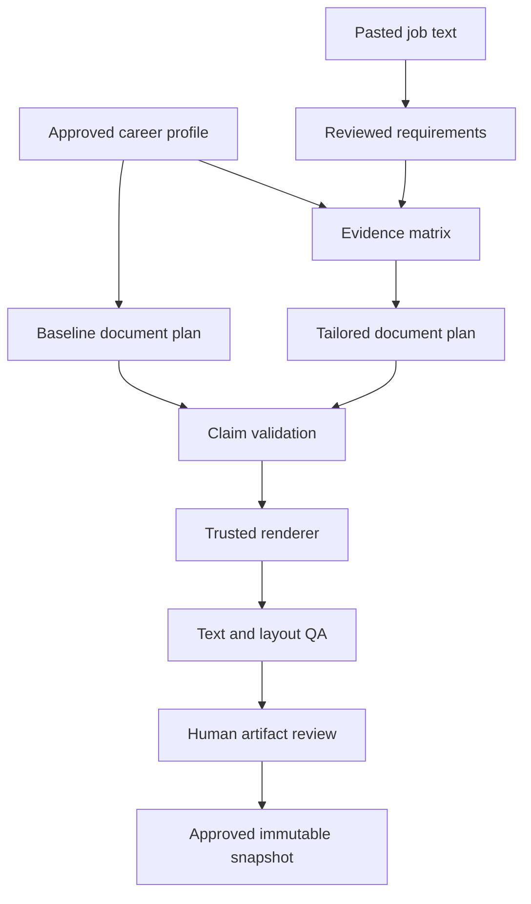

# Architecture

Status: planning architecture independently approved at commit `bea4cbc` on 2026-09-09; see [M0 review](reviews/M0.md). Runtime behavior remains unimplemented until its task passes. ADRs distinguish established foundation decisions from options requiring experiments. See [ADR index](adr/README.md).

## System boundary

One synchronous Python 3.12 package on one laptop. The CLI coordinates pure domain functions and narrow filesystem/rendering adapters. Career JSON and immutable snapshots live in an explicitly configured private data root outside the repository. SQLite is introduced for tracking in M4, not for profile authoring. No HTTP server, frontend, network importer, queue, daemon, container requirement or browser submission process exists in M1–M3.



No submission action follows this graph in the MVP. Human application submission happens outside the software.

## Target repository layout

The following is the intended layout, not a claim these modules already exist. Create modules only for the task that uses them.

```text
src/job_application_engine/
  cli.py
  config.py
  domain/          profile, fact, evidence, variant, document, job, requirement
  profile/         load, validate graph, approve variants, revisions
  ingestion/       pasted text and immutable JD snapshots
  extraction/      source spans, priority, groups, review patches
  normalization/   exact aliases; later ESCO dataset adapter
  matching/        requirement matrix, gaps; later semantic suggestions
  tailoring/       selection and deterministic page budget
  verification/    claim authorization and protected values
  rendering/       document plan to one PDF backend and UTF-8 text
  ats_qa/          extraction, field/order checks, structured results
  snapshots/       content digests, manifests, approvals and export
  tracking/        later SQLite events and query projections
  providers/       later narrow LLM/embedding adapters
templates/         trusted versioned theme, locale labels, approved fonts
tests/             unit, integration, rendering, security, regression
tests/fixtures/    synthetic profiles, EN/DE jobs, adversarial cases
schemas/           generated versioned JSON Schema from domain models
docs/              research, decisions, task specs, review and progress
```

Private runtime layout (not tracked): `profiles/`, `evidence/`, `jobs/`, `snapshots/<id>/`, `approvals/`, `cache/`, `tracking.sqlite3`. Generated outputs and debugging files remain there. `local-data/` is the ignored development fallback. `JAE_DATA_DIR` is required initially; fail rather than silently choose a synced/public location.

## Canonical profile and provenance contracts

Pydantic models use strict fields, bounded strings/collections and forbidden unknown keys. JSON Schema is exported for editors; cross-reference checks run separately. JSON is the first authoring format; YAML can be added through an explicit safe adapter later. One canonical serialization normalizes object-key order, NFC strings and decimal representations; significant array order is preserved.

| Entity | Contract |
|---|---|
| ProfileRevision | `schema_version`, `profile_id`, `revision`, `created_at`, entity indexes, fact/evidence/variant collections; full canonical content digest |
| Entity | Stable local ID for person, employer, role, project, institution or credential; factual display fields point to facts, never unbound prose |
| Fact | Stable `fact_id` + revision; subject ID; typed kind/value; qualifiers/scope; nonempty evidence references; status `draft/approved/revoked`; approval of exact payload and evidence revisions |
| Evidence | ID + revision; kind (`user_attestation`, `document_reference`, `repository_reference`, etc.); immutable local support payload and its content hash; for documentary/repository kinds, document SHA-256 or pinned repository commit/object plus captured support; sensitivity; review identity/time; status. A locator alone cannot be approved evidence |
| SupportBinding | Fact digest, evidence revision/digest and reviewed support scope. This records applicant review of support; a coincidental evidence ID is not enough |
| ApprovedVariant | ID + revision, locale, exact text, nonempty fact references, protected slots/subject scope, support references, hash-bound human review; status `draft/approved/revoked` |
| DocumentPlan | Ordered sections and entries, all visible claim nodes, variant/slot references, pinned profile digest, locale, template/config digest, explicit build date and exclusions |
| ClaimNode | Either an exact approved variant reference or an allowed typed field/formatting operation. Nonempty fact and evidence references are resolved by the compiler, not supplied as unverifiable output by a model |

Keep the implementation small: these are typed records and validation functions, not a knowledge-graph service or generic ontology framework. Entity relationships organize ordinary employment/education sections. No inference engine creates facts.

Every displayed factual value participates: contact details, target professional label, employer and title, dates, education completion, skill possession, project technologies, languages, authorization, metrics and summary claims. Pure section labels, punctuation and page numbers come from a finite static template allowlist. Filenames/metadata must not introduce unsupported professional titles or expose evidence notes.

**Evidence policy:** a deliberate applicant attestation is acceptable evidence, especially for personal responsibilities that have no public document. Record it as an attestation, never as independently certified. Raw certificates/identity scans are unnecessary for the MVP. Imported CV statements and report/chat examples start as draft/unverified; approval must not be supplied by the extraction/generation provider.

For approved documentary/repository evidence, retain a minimal reviewed support capture locally, hash its exact bytes, and bind its origin to the source file SHA-256 or a pinned repository revision/object. An external URL or mutable local path is metadata, not the authoritative evidence payload. Unpinned references remain drafts or are explicitly recorded as applicant attestations with their own reviewed text; do not silently upgrade their evidentiary status. Mutating the captured payload behind the same locator fails validation. Missing required captures fail closed. A removed external original does not invalidate an intact approved capture by itself; a correction, withdrawal or revocation must update the local evidence eligibility record and block affected future exports. This distinction permits minimal captures without storing entire sensitive documents.

## Typed factual semantics

- Dates retain precision (`year` or `month`). Known start, known end, ongoing and unknown are distinct. Only explicit ongoing may become “Present/heute.” A month-level CV cannot invent missing months; selected incomplete entries require correction or an explicitly supported year-only representation with a visible QA warning. Invalid/reversed dates fail. A job that overlaps another is valid and stays visible.
- Education distinguishes ongoing/completed/withdrawn/unknown; degrees are never presented as completed unless approved. Credentials distinguish awarded, in-progress, expired and unknown. Do not silently hide expiry.
- Language level distinguishes CEFR, native/self-description and a named test score. Store assessment/evidence type and date; no conversion from IELTS to CEFR, German prose to fluency, or nationality to native status.
- Authorization is an optional exact applicant-reviewed statement with country/scope, as-of date and expiry if known. Do not calculate legal entitlement. Do not infer it from student status, residence duration or nationality. Expired information requires re-review.
- Numeric facts use decimal strings and typed unit/measure/operator (`exact`, `approximately`, `at_least`, `at_most`), subject, context and time window. Preserve `%` versus percentage points, currencies and baseline/final quantities. Number words and localized decimal punctuation must match the bound fact, not a global bag of numbers.
- Years of experience are absent by default. A manually approved exact statement is allowed. Automated calculation, introduced in TASK-015, unions relevant supported intervals, excludes unsupported periods, retains date precision and uses a pinned as-of date. Never sum concurrent jobs or convert all software years into ML years. Part-time calendar duration is not FTE experience.
- Role title normalizations and translations require separately approved equivalent variants; they cannot upgrade title or seniority. Skills retain context/depth/last-used facts where supported; a broad taxonomy concept is not proof of a specific tool.

## Claim authorization and validation

For every visible ClaimNode, resolve exact revisions, validate the support graph and active approvals, and materialize only the authorized text/typed operation. Compare resulting text with the approved payload; prohibit arbitrary `text + evidence_ids` as a publishing API.

Invariant: `published claim → current approved variant or allowed typed operation → approved scoped fact revisions → reviewed evidence bindings`.

The required graph must be complete and acyclic. Duplicate IDs, dangling references, cycles, revoked evidence, unsupported schema versions, stale approvals and mismatched scopes fail. Generated outputs cannot become their own source evidence. A changed fact forces dependent wording to be reviewed again.

For summaries spanning several facts, the exact combined wording must be approved as a variant. Presence of all source terms does not authorize new causal or leadership relationships. Selection and reordering are automatic; joining/rewriting is constrained to reviewed variants. That is how M1–M3 enforce their guarantee relative to the curated source without pretending to solve arbitrary natural-language entailment.

Later LLM output is `WordingProposal` or `RequirementProposal`, never a `ValidatedDocument`. Proposed wording remains a review report, cannot render as a CV, and fails export until reviewed and recorded against the exact source bundle. Protected entity/number checks run before review; human review cannot bypass invalid IDs or structured contradictions. A second model may flag issues but cannot authorize a claim.

## Pasted jobs and requirement model

Accept UTF-8 text from a file or stdin, bounded initially to 200,000 bytes. No URL fetching. Store raw bytes/hash and a separate normalized representation with its own hash. Preserve line breaks and quote offsets in the raw decoded text; normalization never silently discards requirement-bearing lines.

`Requirement`: ID, raw quote, Unicode-codepoint half-open offsets `[start,end)`, JD digest, kind, priority, priority cue/span/reason, comparison/operator/threshold/unit if applicable, skill concepts, context, negation, review state. `priority = mandatory | preferred | unspecified`; responsibility/context is a distinct kind. Do not force ambiguity into mandatory.

Use an expression tree for supported `ALL`/`ANY` groups (e.g. Python OR Java; degree OR equivalent experience). Preserve negation. If the clause is more complex than the parser supports, emit `needs_review` with the original quote; never silently split an OR into two mandatory requirements. Repeated equivalent requirements can be merged only with retained source spans and identical qualifiers.

English/German rules recognize explicit cues such as “required”, “must”, “preferred”, “nice to have”, “erforderlich”, “zwingend”, “wünschenswert”, “von Vorteil”, and negated forms. Section titles provide evidence, not certainty. Analyst review patches bind to the JD hash and are immutable versions. Extraction covers facts asserted by the advertisement; a JD is never career evidence.

## Matching and tailoring

Each requirement/group maps to `direct`, `equivalent`, `adjacent`, `no_evidence`, `explicitly_unmet`, or `unknown`, with fact/evidence references, method and concise rationale code. Lexical occurrence must refer to an approved **positive** possession/use fact in the proper scope. Adjacent evidence, negative mentions and self-study do not satisfy production or duration requirements.

Exact aliases are reviewed equivalences with directional/scope restrictions; normalize case carefully (`R`, `C`, `C++`, `C#`, `.NET`). ESCO URIs augment internal IDs later. Broader/narrower/related taxonomy links remain typed relations, never alias equivalence.

Report mandatory and preferred coverage separately, including numerator, denominator, group semantics and uncertainty count. No requirements of a class → `N/A`, not 100%. Unknowns remain in the disclosed denominator for conservative coverage. An ANY group counts once and is met when one authorized alternative meets its constraints; an ALL group requires all children. Semantically retrieved suggestions do not count as fulfilled without confirmed support.

No weighted aggregate score in the MVP. Gaps remain visible. A user may prepare a truthful application with missing requirements; quality validation blocks false claims, not the act of applying to an ambitious vacancy.

Tailoring selects approved evidence variants and skills, promotes relevant projects and orders bullets while preserving employment chronology and fixed facts. Start with deterministic greedy selection using explicit priority/relevance and ID tie-breakers; log inclusion/exclusion reasons. Keep role identity/date lines and mandatory sections. Do not delete roles silently to fit pages. Page-budget loop may remove low-priority optional bullets or choose already approved shorter variants. Cap at 20 iterations. If protected content alone exceeds two pages, fail with a list of removable content; no clipping, truncating the PDF, hidden text or tiny fonts.

## Rendering and ATS QA

The renderer consumes only a validated plan. Recommend a narrow RenderCV adapter (ADR-004); TASK-005 compares it against a minimal HTML/Playwright fixture on the real laptop. Do not select a winner by reputation. Pin the winning version, engine, fonts, template and settings. Do not retain both production backends.

Baseline contract: A4; one text column; body 11 pt; margins 20 mm; ordinary bullets; body contacts; standard headings; reverse chronology; photo-free; no icons, tables, sidebars, hidden text or critical headers/footers. 1–2 pages; target <2,000,000 bytes. Full chronology and readability outrank filling a page. No silent auto-shrink.

Use UTF-8 plain text generated from the same ordered claim nodes. Extract actual PDF with Poppler `pdftotext` and pypdf independently; retain both reports. Compare critical fields in their entry/section context and ordered text spans, not just keyword presence. Normalize only documented whitespace/wrapping and NFC; do not strip accents, signs, percent symbols, or numerals. Allowed repeated skills are not automatically duplicate-text errors; unexpected complete duplicate blocks are errors.

Measure text recovery, critical-field recovery, order errors, page count/dimensions, Unicode retention, file size and unsupported claims. Template-policy checks confirm typography and absence of disallowed layout features; mark any unmeasured PDF property `not_checked`, not PASS. Inspect rendered pages for clipping, overlaps and bad breaks. Geometry from Poppler bbox output can detect out-of-page words; it does not replace visual inspection. An optional independent resume parser comes later and is labeled diagnostic.

Renderer threats: candidate text is data, not markup. Escape it through the backend's supported text mechanism; prohibit raw Typst/HTML/template injection, local-file includes and remote assets. Trusted local fonts/templates only; no outbound network. Run bounded subprocesses without a shell, sanitize errors and contain temporary files. M1 tests these controls, including URLs and markup in input.

## Snapshots, approvals and export

Before rendering, compute a build identity from canonical profile/plan/rules/template/locale/as-of digests. Each completed snapshot contains the exact selected source slice and needed evidence/approval records, JD and requirement revisions if applicable, document plan, PDF/TXT, QA results, dependency/tool versions and a manifest of content hashes. Raw sensitive attachments are referenced through private digests/locators, not duplicated unnecessarily. Future LLM results are retained privately as exact proposals/responses; rerunning a model is not expected to reproduce them.

Write a staging directory, validate all files, then atomically publish a new immutable snapshot directory on the same filesystem. Never overwrite an existing snapshot. Failure leaves no ready artifact; incomplete staging directories are identifiable and can be cleaned safely. Content hashes exclude timestamps/approval records that would create a circular hash. PDF byte reproducibility is tested on the pinned platform; semantic reproducibility and exact stored bytes are separate promises.

State machine: `draft → validation_failed` or `draft → qa_passed → awaiting_review → approved`; rejection records a review event. Changes generate a new snapshot at `draft`; old submitted snapshots remain intact. Fact/wording revocation makes affected snapshots ineligible for **new export**, while preserving history. Final approval binds manifest digest, exact PDF/TXT hashes, approver and time; it is stored separately so it does not change the artifact digest.

`export` re-hashes artifacts and retained support captures, resolves current profile/fact/evidence eligibility, checks expiry and QA, and requires matching human approval. Time-limited claims use an explicit applicant-approved `expires_at` or `valid_through` with timezone; absence of an expiry does not authorize a legal-validity inference. Export evaluates the current clock, not a backdated build `--as-of` value. Tests may inject the clock; the normal CLI may not bypass the check. Crossing an explicit expiry boundary requires a new accurate plan and review, even when historical artifact bytes remain intact.

| Condition at export | Eligibility and action |
|---|---|
| Exact approved bytes, intact support captures, current active source/profile revisions, no elapsed expiry, passing QA | Eligible for export |
| PDF/TXT/plan/manifest/support capture changed or hash mismatch | Block; preserve historical record and investigate integrity failure |
| Rebuilt output, changed template/config, or a newer profile/fact/wording revision | Block old approval for the new build; produce/review a new snapshot |
| Fact/evidence corrected or superseded in current source registry | Block affected old snapshot for new export; regenerate from current approved sources |
| Fact/evidence revoked or a required eligibility record/support capture deleted or unavailable | Block; never assume old approval still proves eligibility |
| Time-limited authorization/credential claim expires between build and export | Block; rebuild with current, truthful status or omit the claim, then review |
| External original moved/deleted but immutable reviewed capture and active source eligibility remain available | Capture remains the approved source; no silent refetch or reinterpretation |
| Earlier submitted snapshot has become ineligible | Retain its bytes, historical approval and submission event; do not rewrite history |

Approved eligible bytes may be copied to a chosen submission folder; modified PDFs cannot reuse approval. No in-place editing of approved outputs. The software cannot stop the OS owner manually sending a file; its guarantees apply to its own publication/export path.

## Planned CLI contract

These commands do not exist until the associated tasks are implemented.

| Command | Behavior |
|---|---|
| `jae profile validate --profile PATH` | Validate schema, graph, protected fields and revisions; sanitized errors |
| `jae profile review --profile PATH` | Record human fact/variant approval against displayed exact content |
| `jae cv build --profile PATH --locale en --as-of YYYY-MM-DD` | Baseline candidate PDF/TXT, QA and private snapshot; no network |
| `jae job ingest --text PATH` | Pasted text snapshot; `--text -` reads stdin |
| `jae job analyze --job ID` | Requirement proposals and exact/alias matrix |
| `jae job review --job ID` | Review requirements; preserve patches and source version |
| `jae cv tailor --profile PATH --job ID --as-of YYYY-MM-DD` | Select only approved variants; rerun all validation and QA |
| `jae application review --snapshot ID` | Display artifacts and gaps; collect explicit approval of exact hashes |
| `jae application export --snapshot ID --destination PATH` | Revalidate and copy approved bytes; fail on mismatch |

Exit codes: 0 command succeeded; 2 usage/schema/input error; 3 unsupported/stale claim; 4 rendering or QA failure; 5 missing/stale human approval; 6 missing dependency/provider failure. Job gaps are recorded in a successful analysis and do not masquerade as software failures. Include stable machine-readable error codes and minimal context.

## Later boundaries

M4 tracker uses sqlite3 with foreign keys, migrations, transactions and append-only status events referencing immutable snapshot IDs; mutable views are derived from events. Provider interfaces are introduced at first use: `RequirementProposer`, `WordingProposer`, `EmbeddingEncoder`. The offline pipeline remains complete if they are absent. Record model/revision/config/prompt hash; no provider gets filesystem/browser/credential tools.

Future source integration receives an approved application snapshot reference, never permission to modify career data. Source policy includes origin, allowed operations, permission basis/review date and required manual checks; default deny. An authenticated browser must be isolated from rendering and model execution. Do not implement speculative submission endpoints now.
